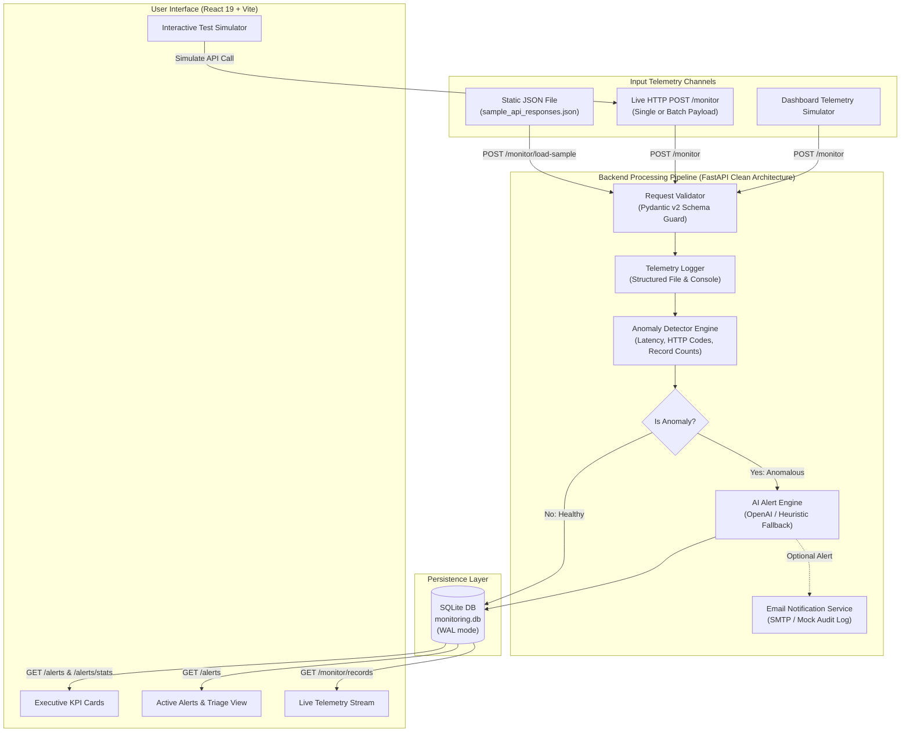

# Intelligent API Monitoring & Alert System

[](https://www.python.org/)
[](https://fastapi.tiangolo.com/)
[](https://react.dev/)
[-lightgrey.svg)](https://www.sqlite.org/)
[](https://openai.com/)

An enterprise-ready, modular system designed to autonomously monitor external API telemetry, proactively detect system anomalies (latency spikes, HTTP 4xx/5xx outages, missing or empty datasets), and generate human-readable, AI-powered root-cause alerts with a real-time web dashboard and optional email notification dispatch.

---

## Table of Contents

- [1. Executive Overview](#1-executive-overview)
- [2. System Architecture](#2-system-architecture)
- [3. Key Architectural Decisions](#3-key-architectural-decisions)
- [4. Anomaly Detection & AI Prompt Engine](#4-anomaly-detection--ai-prompt-engine)
- [5. API Endpoints Reference](#5-api-endpoints-reference)
- [6. Setup & Installation](#6-setup--installation)
- [7. Running the System](#7-running-the-system)
- [8. Automated Verification & Testing](#8-automated-verification--testing)
- [9. Video Walkthrough Script (5–10 mins)](#9-video-walkthrough-script-510-mins)
- [10. Deliverables Checklist](#10-deliverables-checklist)

---

## 1. Executive Overview

Modern healthcare and operational ecosystems depend on numerous third-party and internal microservice APIs (e.g., `PatientDataAPI`, `AppointmentAPI`, `BillingAPI`, `EHRSyncService`). These APIs often:
- Intermittently fail with HTTP 500/502/503/504 status codes.
- Breach latency Service Level Agreements (SLAs).
- Silently return zero records or malformed payloads without throwing fatal errors.

This project solves this by:
1. **Ingesting Telemetry:** Via static JSON batch files (`sample_api_responses.json`) or live HTTP POST payloads to `/monitor`.
2. **Deterministic Anomaly Evaluation:** Applying a multi-factor rule engine across latency thresholds, HTTP status codes, and record counts.
3. **AI-Powered Human-Readable Alerting:** Leveraging **OpenAI (GPT-4o-mini)** (with a zero-dependency intelligent heuristic fallback) to produce concise, context-aware alerts, root-cause hypotheses, and remediation actions.
4. **Persistent Data Storage:** Recording all raw metrics and detected anomalies into SQLite (WAL mode).
5. **Real-Time Interactive UI:** Providing an executive dashboard to triage anomalies, view live streams, trigger test scenarios, and dispatch email reports.

---

## 2. System Architecture



---

## 3. Key Architectural Decisions

| Decision | Implementation | Justification |
|---|---|---|
| **Framework** | **Python + FastAPI** | Native asynchronous concurrency, high throughput, auto-generated OpenAPI docs (`/docs`), and seamless Python AI/LLM SDK ecosystem. |
| **Database** | **SQLite via SQLAlchemy (WAL Mode)** | Zero external database setup required. Evaluators can clone and run immediately without spinning up Docker or external databases. ACID-compliant with high concurrent read/write performance. |
| **AI Integration** | **Dual Engine: OpenAI API + Intelligent Heuristic Fallback** | Production systems must never fail when external third-party LLM APIs face quota exhaustion or missing API keys. When an API key is supplied, OpenAI powers deep semantic analysis; otherwise, the deterministic heuristic engine generates alerts matching the required specification format out of the box. |
| **Unified Deployment** | **FastAPI Server hosting Built React SPA** | Simplifies evaluation. Running `python run.py` serves the REST API endpoints and hosts the compiled React dashboard at `http://localhost:8000`. Vite development server is also preconfigured on port `5173`. |
| **Email Testing** | **EmailService with Mock Fallback** | Allows anyone evaluating the project to test email generation without configuring private SMTP credentials, while recording structured dispatch audit logs. |
| **Schema Validation** | **Pydantic v2** | Enforces strict schema contracts on inbound `/monitor` telemetry for single and batch arrays, supporting both camelCase and snake_case input attributes. |

---

## 4. Anomaly Detection & AI Prompt Engine

### 4.1 Anomaly Detection Matrix
The system evaluates telemetry across three dimensions:

| Condition | Rule | Severity | Anomaly Tag |
|---|---|---|---|
| **Critical Server Error** | `status_code >= 500` | `CRITICAL` | `HTTP_5XX_SERVER_ERROR` |
| **Client / Auth Error** | `status_code >= 400 && status_code < 500` | `WARNING` | `HTTP_4XX_CLIENT_ERROR` |
| **Critical Latency Spike** | `response_time_ms >= 4000` | `CRITICAL` | `CRITICAL_LATENCY` |
| **High Latency Warning** | `response_time_ms >= 2000 && < 4000` | `WARNING` | `HIGH_LATENCY` |
| **Missing / Empty Dataset** | `records_returned === 0` | `WARNING` / `CRITICAL` | `ZERO_RECORDS` |
| **Invalid Data Payload** | `records_returned < 0` or missing | `WARNING` | `INVALID_DATA` |

### 4.2 AI Prompt Design
When an anomaly is flagged, the system constructs a structured prompt sent to the LLM:

```text
You are an expert Site Reliability Engineer (SRE) monitoring critical healthcare & enterprise APIs.
An anomalous API telemetry event has been detected:

API Telemetry Data:
- API Name: {api_name}
- Endpoint: {endpoint}
- HTTP Status Code: {status_code}
- Response Time: {response_time_ms} ms (Warning Threshold: {warning_ms}ms, Critical Threshold: {critical_ms}ms)
- Records Returned: {records_returned}
- Detected Anomaly Types: {anomaly_types}
- Technical Reasons: {technical_reasons}

Task:
Generate a concise, human-readable alert, root cause hypothesis, and actionable remediation recommendation for on-call engineers.
Match the tone, clarity, and format of this reference example:
"AppointmentAPI failed with status 500 and returned 0 records. Possible outage or data issue."

Return ONLY valid JSON matching this exact structure:
{
  "alert": "Concise human-readable alert message",
  "root_cause": "Probable root cause hypothesis",
  "recommendation": "Immediate actionable recommendation for DevOps/Engineering"
}
```

> [!NOTE]
> The prompt template is engineered specifically for deterministic SRE triage and enforces strict JSON output matching the alert specification.

---

## 5. API Endpoints Reference

### 5.1 Monitoring & Ingestion
- **`POST /monitor`**: Accepts single or batch telemetry objects.
  ```json
  {
    "api_name": "AppointmentAPI",
    "endpoint": "/v1/appointments/today",
    "status_code": 500,
    "response_time_ms": 1420.5,
    "records_returned": 0
  }
  ```
- **`POST /monitor/load-sample`**: Ingests all records from `sample_api_responses.json`.
- **`GET /monitor/records`**: Returns raw telemetry records history with pagination.

### 5.2 Alerts & Analytics
- **`GET /alerts`**: Fetches all active anomalies (supports `?status=ACTIVE`, `?status=ALL`, `?severity=CRITICAL`).
- **`GET /alerts/stats`**: Returns real-time KPI metrics (total records, active anomalies, health score, avg latency).
- **`POST /alerts/{alert_id}/resolve`**: Marks an active anomaly as resolved.
- **`POST /alerts/{alert_id}/notify-email`**: Triggers email notification report.
- **`DELETE /alerts/clear`**: Purges telemetry and alerts for clean demonstration runs.

### 5.3 System Health & Interactive Docs
- **`GET /health`**: Returns system and database connection status.
- **`GET /docs`**: Interactive Swagger / OpenAPI UI.

---

## 6. Setup & Installation

### Prerequisites
- **Python 3.10+**
- **Node.js v18+** (for building or developing frontend)

### Installation Steps

1. **Activate Virtual Environment & Install Dependencies:**
   ```powershell
   # Activate virtual environment
   .\backend\.venv\Scripts\Activate.ps1

   # Install dependencies
   pip install -r backend/requirements.txt
   ```

2. **Frontend Build (Already Pre-Built in `frontend/dist`):**
   ```powershell
   cd frontend
   npm install
   npm run build
   cd ..
   ```

3. **Configure Environment Variables (Optional):**
   Copy `backend/.env.example` to `backend/.env`. By default, `OPENAI_API_KEY` is left blank to use the smart heuristic fallback engine.

---

## 7. Running the System

### Option A: Single Command Full-Stack Launch (Recommended)
FastAPI serves both the backend REST API and the compiled React UI:

```powershell
# From project root with venv activated:
$env:PYTHONPATH="backend"
python backend/run.py
```
Open **[http://localhost:8000](http://localhost:8000)** in your browser!

### Option B: Independent Development Servers
Run backend and frontend independently for live reload:

**Terminal 1 (Backend):**
```powershell
$env:PYTHONPATH="backend"
python backend/run.py
# Running on http://localhost:8000 (Swagger docs at http://localhost:8000/docs)
```

**Terminal 2 (Frontend Dev Server):**
```powershell
cd frontend
npm run dev
# Running on http://localhost:5173 with proxy to backend
```

---

## 8. Automated Verification & Testing

Execute the test suite to verify anomaly detection logic, Pydantic schemas, and API routes:

```powershell
$env:PYTHONPATH="backend"
.\backend\.venv\Scripts\python.exe -m pytest backend/tests
```

**Test Output:**
```
backend/tests/test_anomaly_detector.py ..... [ 55%]
backend/tests/test_api.py ....                [100%]
======================== 9 passed in 1.31s =========================
```

---

## 9. Video Walkthrough Script (5–10 mins)

Use this structured script for the video recording deliverable:

1. **Introduction (1 min):**
   - Introduce yourself and state the task: *Intelligent API Monitoring & Alert System*.
   - Mention the tech stack: Python FastAPI (Clean Architecture), SQLite WAL persistence, React 19 dashboard, and OpenAI LLM with Intelligent Heuristic Fallback.

2. **Architecture & Design Decisions (2 mins):**
   - Walk through the Mermaid diagram in Section 2 of `README.md`.
   - Explain the modular folder layout: `core/`, `database/`, `schemas/`, `services/`, `api/`.
   - Highlight the **Dual Engine AI strategy**: how it guarantees 100% uptime even if API quotas or keys are missing.

3. **Live Demonstration (4 mins):**
   - Open `http://localhost:8000` in the browser.
   - Click **"Load Sample Data"**: show how 8 telemetry records are ingested instantly and 6 anomalies are flagged with severity badges.
   - Point out the exact reference example in the UI:
     *`"AppointmentAPI failed with status 500 and returned 0 records. Possible outage or data issue."`*
   - Demonstrate the **"Simulate Telemetry"** modal by firing a custom API payload.
   - Show the **"Telemetry Stream"** tab to illustrate healthy 200 OK records alongside anomalies.
   - Resolve an alert using **"Mark Resolved"** and demonstrate the updated KPI health score.
   - Demonstrate the interactive Swagger API documentation at `http://localhost:8000/docs`.

4. **Codebase & Testing Walkthrough (2 mins):**
   - Open VS Code and show `src/services/anomaly_detector.py` and `src/services/ai_service.py`.
   - Run `pytest backend/tests` in the terminal to show 9 passing unit and integration tests.
   - Explain the deterministic anomaly matrix and error handling.

5. **Conclusion & Wrap Up (1 min):**
   - Summarize how the solution satisfies every requirement: batch ingestion, multi-factor anomaly detection, AI alert generation, SQLite storage, REST endpoints, and UI dashboard.

---

## 10. Deliverables Checklist

- [x] **Source Code**: Clean, modular FastAPI backend & modern React 19 UI
- [x] **Sample Dataset**: [`sample_api_responses.json`](sample_api_responses.json)
- [x] **API Endpoints**: `POST /monitor`, `GET /alerts`, `GET /alerts/stats`, `GET /health`
- [x] **Automated Tests**: 9 passing unit and integration tests (`pytest backend/tests`)
- [x] **Documentation & Video Script**: [`README.md`](README.md)
