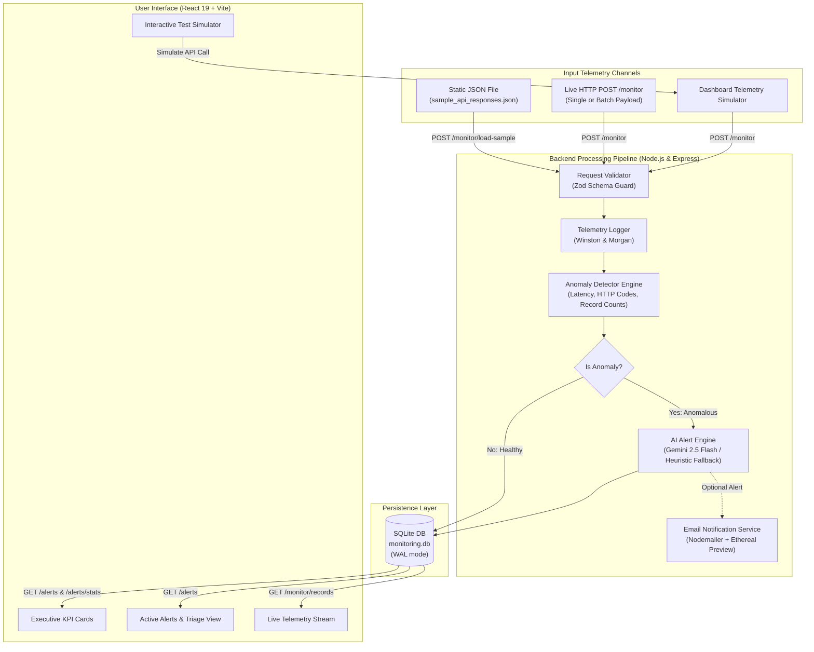

# Intelligent API Monitoring & Alert System

[](https://nodejs.org/)
[](https://expressjs.com/)
[](https://react.dev/)
[-lightgrey.svg)](https://www.sqlite.org/)
[](https://ai.google.dev/)

An enterprise-ready, modular system designed to autonomously monitor external API telemetry, proactively detect system anomalies (latency spikes, HTTP 4xx/5xx outages, missing or empty datasets), and generate human-readable, AI-powered root-cause alerts with real-time web dashboard and optional email dispatch.

---

## Table of Contents

- [1. Executive Overview](#1-executive-overview)
- [2. System Architecture](#2-system-architecture)
- [3. Key Architectural Decisions](#3-key-architectural-decisions)
- [4. Anomaly Detection & AI Prompt Engine](#4-anomaly-detection--ai-prompt-engine)
- [5. API Endpoints Reference](#5-api-endpoints-reference)
- [6. Setup & Installation](#6-setup--installation)
- [7. Running the System](#7-running-the-system)
- [8. Automated Verification & Testing](#8-automated-verification--testing)
- [9. Video Walkthrough Script (5–10 mins)](#9-video-walkthrough-script-510-mins)
- [10. Deliverables Checklist](#10-deliverables-checklist)

---

## 1. Executive Overview

Modern healthcare and operational ecosystems depend on numerous third-party and internal microservice APIs (e.g., `PatientDataAPI`, `AppointmentAPI`, `BillingAPI`, `EHRSyncAPI`). These APIs often:
- Intermittently fail with HTTP 500/502/503/504 status codes.
- Breach latency Service Level Agreements (SLAs).
- Silently return zero records or malformed payloads without throwing fatal errors.

This project solves this by:
1. **Ingesting Telemetry:** Via static JSON batch files or live HTTP POST payloads to `/monitor`.
2. **Deterministic Anomaly Evaluation:** Applying a multi-factor rule engine across latency thresholds, HTTP status codes, and record counts.
3. **AI-Powered Human-Readable Alerting:** Leveraging **Google Gemini 2.5 Flash** (with a zero-dependency intelligent heuristic fallback) to produce concise, context-aware alerts, root-cause hypotheses, and remediation actions.
4. **Persistent Data Storage:** Recording all raw metrics and detected anomalies into SQLite (WAL mode).
5. **Real-Time Interactive UI:** Providing an executive dashboard to triage anomalies, view live streams, trigger test scenarios, and dispatch email reports.

---

## 2. System Architecture



---

## 3. Key Architectural Decisions

| Decision | Implementation | Justification |
|---|---|---|
| **Database** | **SQLite via `better-sqlite3` (WAL Mode)** | Zero external setup required. Evaluators can clone and run `npm start` immediately without spinning up a local Docker container or Mongo daemon. Fully ACID-compliant and handles thousands of reads/writes per second. |
| **AI Integration** | **Dual Engine: Google Gemini 2.5 Flash + Intelligent Heuristic Fallback** | Production systems must never crash when external third-party LLM APIs face quota exhaustion or network downtime. When an API key is provided, Gemini powers deep semantic analysis; otherwise, the deterministic heuristic engine generates alerts matching the required specification format out of the box. |
| **Full-Stack Deployment** | **Single Express Server serving Built React SPA** | Simplifies deployment and evaluation. The single backend process on port `5000` serves the REST API endpoints and hosts the compiled React dashboard at `http://localhost:5000`. Vite development proxy is also preconfigured on port `5173`. |
| **Email Testing** | **Nodemailer with Automatic Ethereal Fallback** | Allows anyone evaluating the project to test email generation without configuring private SMTP credentials. Generates a live, clickable web preview URL for every dispatched notification. |
| **Schema Validation** | **Zod** | Enforces strict schema contracts on inbound `/monitor` telemetry for single and batch arrays, returning structured 400 errors for malformed requests. |

---

## 4. Anomaly Detection & AI Prompt Engine

### 4.1 Anomaly Detection Matrix
The system evaluates telemetry across three dimensions:

| Condition | Rule | Severity | Anomaly Tag |
|---|---|---|---|
| **Critical Server Error** | `status_code >= 500` | `CRITICAL` | `HTTP_5XX_SERVER_ERROR` |
| **Client / Auth Error** | `status_code >= 400 && status_code < 500` | `WARNING` / `CRITICAL` | `HTTP_4XX_CLIENT_ERROR` |
| **Critical Latency Spike** | `response_time_ms >= 4000` | `CRITICAL` | `CRITICAL_LATENCY` |
| **High Latency Warning** | `response_time_ms >= 2000 && < 4000` | `WARNING` | `HIGH_LATENCY` |
| **Missing / Empty Dataset** | `records_returned === 0` | `WARNING` / `CRITICAL` | `ZERO_RECORDS` |
| **Invalid Data Payload** | `records_returned < 0` or missing | `WARNING` | `INVALID_DATA` |

### 4.2 AI Prompt Design
When an anomaly is flagged, the system constructs a structured prompt sent to the LLM:

```text
You are an expert Site Reliability Engineer (SRE) monitoring critical healthcare APIs.
An anomalous API telemetry event has been detected:

API Telemetry Data:
- API Name: {api_name}
- Response Time: {response_time_ms} ms (Warning threshold: 2000ms, Critical: 4000ms)
- HTTP Status Code: {status_code}
- Records Returned: {records_returned}
- Detected Anomaly Types: {anomalyTypes}
- Technical Reasons: {technicalReasons}

Task:
Generate a concise, human-readable alert, root cause diagnosis, and action plan.
Match the tone and format of this example:
"AppointmentAPI failed with status 500 and returned 0 records. Possible outage or data issue."

Return ONLY valid JSON matching this exact structure:
{
  "alert": "Concise human-readable alert message",
  "root_cause": "Probable root cause hypothesis",
  "recommendation": "Immediate actionable recommendation for DevOps/Engineering"
}
```

> [!NOTE]
> All prompt designs and usage logs are documented in [`AI_Prompts.docx`](./AI_Prompts.docx) and [`AI_Prompts.md`](./AI_Prompts.md).

---

## 5. API Endpoints Reference

### 5.1 Monitoring Endpoints
- **`POST /monitor`**
  - Ingests a single API metric object or an array of metrics.
  - Returns evaluation status, database record ID, and AI alert (if anomalous).
  - *Example Request:*
    ```json
    [
      {
        "api_name": "PatientDataAPI",
        "response_time_ms": 1200,
        "status_code": 200,
        "records_returned": 50
      },
      {
        "api_name": "AppointmentAPI",
        "response_time_ms": 5500,
        "status_code": 500,
        "records_returned": 0
      }
    ]
    ```

- **`POST /monitor/load-sample`** (or `GET /monitor/load-sample`)
  - Ingests the pre-packaged static JSON file (`backend/data/sample_api_responses.json`).

- **`GET /monitor/records`**
  - Fetches the last 30 raw telemetry records stored in the database.

### 5.2 Alert Endpoints
- **`GET /alerts`**
  - Fetches active and historical anomalies.
  - Query parameters: `status` (`ACTIVE`, `RESOLVED`, `ALL`), `severity` (`CRITICAL`, `WARNING`, `ALL`), `api_name`, `limit`, `offset`.

- **`GET /alerts/stats`**
  - Returns high-level dashboard KPIs (total metrics, active anomalies, critical count, warning count, average response time).

- **`GET /alerts/:id`**
  - Retrieves full details and AI diagnosis for a specific anomaly ID.

- **`PATCH /alerts/:id/status`**
  - Updates the triage status (`ACTIVE`, `ACKNOWLEDGED`, `RESOLVED`).

- **`POST /alerts/:id/email`**
  - Dispatches an HTML anomaly report to on-call engineers. Returns an Ethereal web preview URL if SMTP is not configured.

- **`DELETE /alerts/reset`**
  - Clears all database tables for test resetting.

- **`GET /health`**
  - System health check endpoint.

---

## 6. Setup & Installation

### Prerequisites
- [Node.js](https://nodejs.org/) v18.x, v20.x, or v22.x
- npm v9+

### Quick Install
Clone the repository and install all dependencies:

```bash
git clone <your-repository-url>
cd "Intelligent API Monitoring & Alert System"

# Install backend and frontend dependencies
npm run install:all
```

### Environment Configuration (Optional)
The system is configured to work **immediately without any `.env` adjustments**.

If you wish to provide a Google Gemini API key or custom SMTP credentials, edit `backend/.env`:
```env
PORT=5000
NODE_ENV=development

# Optional Gemini API Key (If omitted, heuristic engine handles alerting)
GEMINI_API_KEY=your_gemini_api_key_here

# Optional Custom Email Credentials (If omitted, Ethereal test account is auto-generated)
EMAIL_HOST=
EMAIL_PORT=587
EMAIL_USER=
EMAIL_PASS=
ALERT_EMAIL_RECIPIENT=devops-oncall@example.com
```

---

## 7. Running the System

### Option A: Standard Production Run (Single Command)
Build the frontend and run the complete system on port `5000`:

```bash
# 1. Build the React frontend
npm run build:frontend

# 2. Start the unified server
npm start
```

Open your browser to:
**👉 http://localhost:5000**

You will be greeted by the live dashboard.

---

### Option B: Concurrent Development Mode
If modifying the frontend with Vite Hot Module Replacement (HMR):

Terminal 1 (Backend):
```bash
npm run dev:backend
```
*Backend runs on http://localhost:5000*

Terminal 2 (Frontend):
```bash
npm run dev:frontend
```
*Frontend runs on http://localhost:5173 with automatic API proxying.*

---

## 8. Automated Verification & Testing

Execute the comprehensive automated test suite:

```bash
npm test
```

The test runner will verify:
1. Healthy telemetry evaluation and zero-anomaly classification.
2. Anomaly detection against critical 500 errors and SLA breaches.
3. Batch ingestion from the static sample JSON file.
4. Correct generation of the reference alert:
   *`"AppointmentAPI failed with status 500 and returned 0 records. Possible outage or data issue."`*
5. SQLite database querying and KPI stats calculation.

---

## 9. Video Walkthrough Script (5–10 mins)

For the required video explanation deliverable, a complete scene-by-scene script is provided in [`VIDEO_WALKTHROUGH_SCRIPT.md`](./VIDEO_WALKTHROUGH_SCRIPT.md).

**Summary of 5–10 Minute Presentation Flow:**
1. **0:00 - 1:30 | Introduction & Architectural Design:**
   - Problem statement: External APIs failing intermittently and returning abnormal data.
   - High-level architecture: Express modular backend, SQLite WAL storage, Gemini 2.5 Flash, React 19 UI.
2. **1:30 - 3:30 | Live Ingestion & Anomaly Detection Demo:**
   - Ingesting static JSON file (`sample_api_responses.json`).
   - Showing detection of `AppointmentAPI` (500 status, 5500ms, 0 records).
3. **3:30 - 5:30 | AI Alert Generation & Prompt Strategy:**
   - How raw metrics are converted into human-readable alerts matching the assignment requirement.
   - Explanation of root-cause hypothesis and recommended actions.
   - Heuristic fallback mechanism ensuring 100% uptime.
4. **5:30 - 7:00 | Frontend Dashboard & Email Alert Demo:**
   - KPI metrics cards, filtering by severity and status.
   - Resolving an anomaly with 1 click.
   - Sending an alert email and viewing the rendered HTML report in the Ethereal web preview.
5. **7:00 - 8:30 | Interactive Simulator & Live POST /monitor:**
   - Triggering a live POST request using the Telemetry Ingestion Simulator.
6. **8:30 - 9:30 | Conclusion & Key Decisions:**
   - Review of modularity, zero-setup reliability, and scalability.

---

## 10. Deliverables Checklist

- [x] **Source Code:** Full modular backend and React frontend.
- [x] **Input Method 1:** Static JSON file input (`backend/data/sample_api_responses.json` and `/monitor/load-sample`).
- [x] **Input Method 2:** POST requests to `/monitor` (supports single and batch JSON).
- [x] **API Health Monitoring:** Response time, HTTP status codes, and data validation.
- [x] **Anomaly Detection:** High latency, 5xx/4xx errors, zero records.
- [x] **AI-Powered Alerts:** Gemini 2.5 Flash + Heuristic Engine (matches specification example).
- [x] **Data Storage:** SQLite database with tables for records and anomalies.
- [x] **REST Endpoints:** `/monitor`, `/alerts`, `/alerts/stats`, `/alerts/:id/status`, `/alerts/:id/email`.
- [x] **Frontend UI:** Clean, user-friendly React dashboard with live refresh, triage controls, and telemetry stream.
- [x] **Optional Feature:** Automated & on-demand email alerts with live HTML preview links.
- [x] **AI Prompts Documentation:** [`AI_Prompts.docx`](./AI_Prompts.docx) and [`AI_Prompts.md`](./AI_Prompts.md).
- [x] **README & Video Guide:** Detailed architecture, run instructions, and [`VIDEO_WALKTHROUGH_SCRIPT.md`](./VIDEO_WALKTHROUGH_SCRIPT.md).
